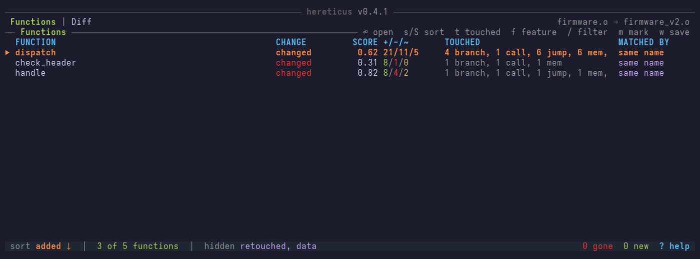
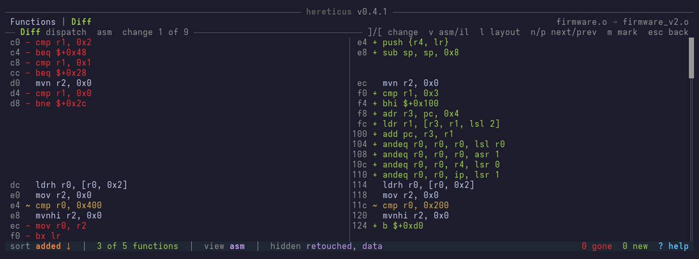
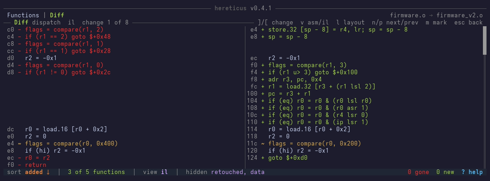
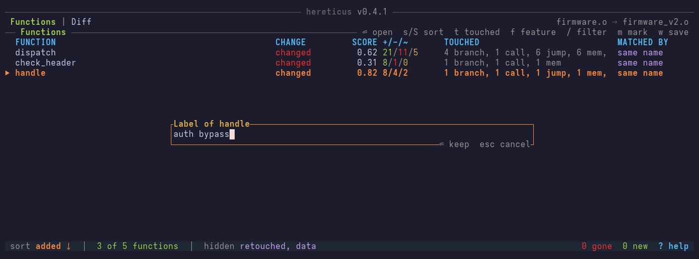
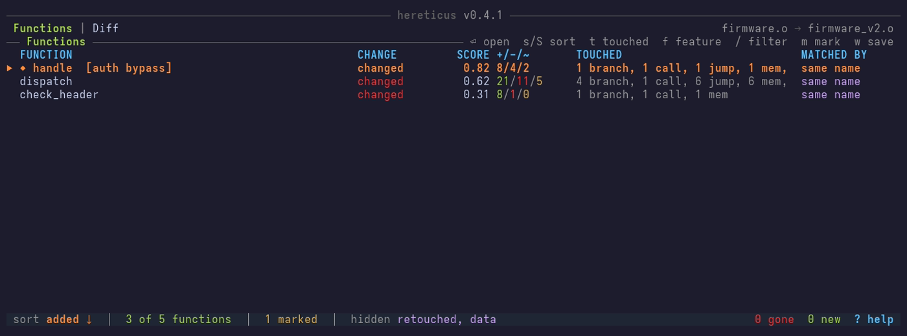

# Terminal Interface

`--tui` compares the two binaries once, then lets you browse the report in
the terminal. You can sort it, filter it, and open the diff of each
function, with no second run:

```console
$ hereticus --tui fw-v1.elf fw-v2.elf
```

## The Functions

The first screen is the report, with the changed functions first. The
functions that are gone or new come after the pairs.



- `s` changes the order, and `S` reverses it.
- `t` lists only the pairs that touched one kind of code, as `call`.
- `f` lists only the pairs with one feature, as `added-call`. Each press
  goes to the next feature that `--only` takes, and after the last one,
  to every pair. `--only` sets the features that the browser starts with.
- `/` filters on the names. The letters must come in order, but need not
  be next to each other.
- `a` shows every function, `r` the pairs that changed only a constant,
  and `d` the data regions.
- `Enter`, or a second click, opens the diff of the selected function.

## The Diff

The diff shows the two bodies side by side, with the address of each
instruction. Red lines were removed, green lines were added, and yellow
lines changed only a value:



`v` shows the same diff as IL statements, which read alike on each
architecture:



- `]` and `[` go to the next and the previous change.
- `v` changes between assembly and IL.
- `l` changes between two columns and one.
- `n` and `p` go to the next and the previous function.
- `Esc` goes back to the list.

## Marks and Projects

A large comparison can take minutes, and a review can take days. Save it
as a project, and open it again later with no second match.

- `m` marks the selected function, and asks for a label, as
  `auth bypass`. The label can be empty. `m` again changes the label, and
  `M` removes the mark.

  

- A marked function goes to the top of the list, with `◆` before its name
  and its label after it. It stays in the list when `a`, `r`, `d`, `t` or
  `f` would hide it. `/` finds it by its label too.

  

- `w` saves the project. It asks for a path, and gives the last one.
- `q` warns when a mark is not saved.

A project holds the result of the match, the marks, and the state of the
browser: the order, the filters, the view, the selected function, and the
open diff. To go on where you stopped:

```console
$ hereticus --tui --open fw-v1.elf-fw-v2.elf.hereticus.json
```

`--save` makes a project with no browser, as for a match that runs at night.
It prints the report too:

```console
$ hereticus --save fw.hereticus.json fw-v1.elf fw-v2.elf
$ hereticus --tui --open fw.hereticus.json
```

With `--tui`, `w` then offers that path. With `--open`, `--save` copies the
project, with its marks.

Without `--tui`, `--open` prints the report as a new run on the two
binaries does, and takes the same flags: `--format`, `--sort`, `--diff`,
`--diff-all` and the others. It does not take the flags that read the
binaries, as `--raw` or `--threshold`, because the project keeps them.

Each report shows the marks as the browser does. The marked functions come
first, also when a filter would hide them, as `◆ handle [auth bypass]`:

- `--format compact` adds a last column to a marked line, as
  `◆ auth bypass`. The other lines keep their columns.
- `--format json` adds `"mark": "auth bypass"` to a marked function.
- `--diff` finds a function by its label too, as
  `--diff "auth bypass"`.

A project is JSON, and names each binary by its full path, with a SHA-256
hash. The binaries stay where they are.

> [!IMPORTANT]
> A project does not open when a binary moved or changed, or when this
> version of `hereticus` finds other functions in it. Compare the binaries
> again in that case.

## All Keys

`?` shows each key, on each screen.

| Key | In the list | In the diff |
|-----|-------------|-------------|
| `j` / `k` | down / up | down / up |
| `PgDn` / `PgUp` | a page down / up | a page down / up |
| `g` / `G` | first / last | top / bottom |
| `Enter` | open the diff | |
| `s` / `S` | next order / reverse the order | |
| `t` | next kind touched | |
| `f` | next feature | |
| `a` / `r` / `d` | every function / retouched pairs / data regions | |
| `/` | filter the names | |
| `]` / `[` | | next / previous change |
| `v` | | assembly or IL |
| `l` | | side by side or one column |
| `n` / `p` | | next / previous function |
| `Esc` | | back to the list |
| `m` / `M` | mark and label / unmark | mark and label / unmark |
| `w` | save the project | save the project |
| `?` | this help | this help |
| `q` | quit, after a question | quit, after a question |

The mouse wheel scrolls, and a click selects a row.

The screenshots come from `book/tapes/tui.tape`. To make them again, run
`just book-media`. The tests of `hereticus-cli/src/tui/` lock the
text of each screen, and `hereticus-cli/tests/book_media.rs` fails when a
screen changes after the screenshots were made.
